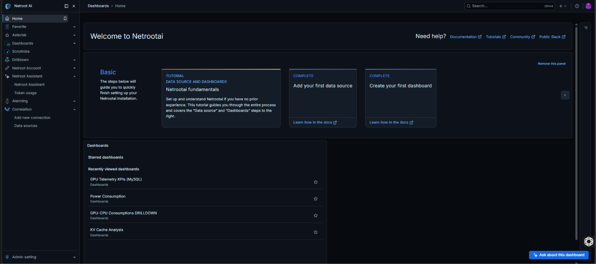
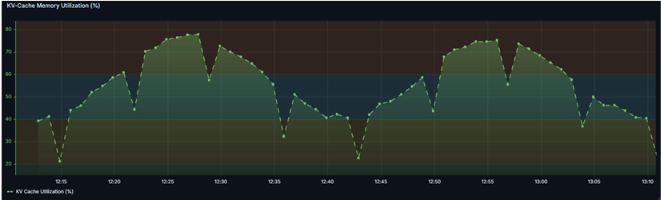
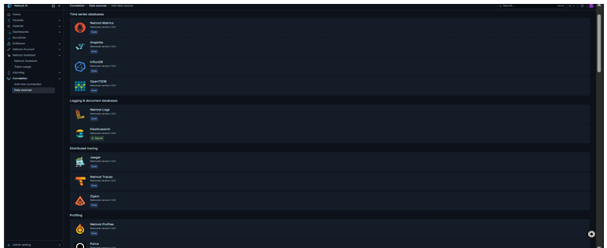
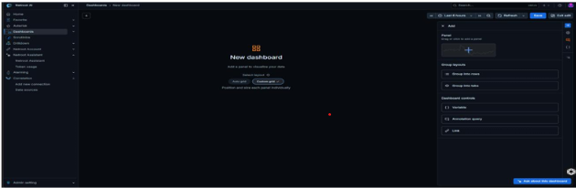
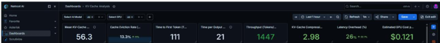

# Netrootai Telemetry & Analysis Dashboard

> **Quick Link:** [Download the Detailed Guide PDF](Netrootai%20KV_Detailed%20Guide%20For%20github%20(2).pdf)[cite: 22]

## Overview
The Netrootai Telemetry & Analysis Dashboard provides a consolidated view of model performance, GPU-related telemetry, KV-cache behavior, throughput, latency, and estimated infrastructure cost[cite: 22]. It brings key indicators and time-series views into one workspace so users can review performance patterns and compare selected model and GPU configurations[cite: 22].

[cite: 22]

### 1.1 Key Capabilities
* **Multi-Source Data Integration:** Connect and unify telemetry from multiple Netrootai Analytics-compatible data sources, including SQL databases and time-series engines[cite: 22].
* **Flexible Infrastructure Scope:** Adaptable across compute workloads, covering CPU and GPU performance, memory pressure, and cluster network telemetry[cite: 22].
* **Interactive Dashboarding:** Enable rich visual exploration through adjustable time ranges, dynamic refresh intervals, entity-based filtering, and metric comparisons[cite: 22].
* **Statistical KPI Engine:** Support rolling statistical analysis, including mean, median, and standard deviation, using configurable sample windows to identify performance patterns and variations[cite: 23].
* **Custom Query Builder:** Enable users to write native SQL queries within Netrootai Analytics to calculate customized domain-specific metrics, filters, and aggregations[cite: 23].
* **Query Optimization:** Support efficient data retrieval through indexed telemetry schemas, targeted time-range filters, and optimized query execution[cite: 23].
* **Netrootai LLM Assistant:** Provide an integrated large language model (LLM)-powered assistant that helps users interpret dashboard information and understand telemetry reports in depth[cite: 23]. The assistant translates complex metrics, charts, and performance patterns into clear, contextual explanations, helping users identify anomalies, investigate potential bottlenecks, and understand relationships between infrastructure and workload indicators[cite: 23].
* **Intelligent Root-Cause Analysis and Recommendations:** Analyze visible dashboard findings to suggest possible reasons for performance degradation, memory pressure, increased latency, or throughput fluctuations[cite: 23]. The assistant can recommend precautionary measures and follow-up investigations, such as reviewing resource allocation, examining cache eviction patterns, evaluating batch sizes, and monitoring relevant KPIs[cite: 23]. These recommendations support troubleshooting and operational decision-making and should be validated against telemetry evidence and infrastructure context[cite: 23].

### 1.2 Opening the dashboard
1. Open the Netrootai Telemetry & Analysis Dashboard using the URL supplied by your administrator or project team[cite: 23].
2. Sign in if your deployment requires authentication[cite: 23].
3. Open the relevant telemetry dashboard from the dashboard navigation[cite: 23].
4. Use the time-range control to select the period you want to inspect[cite: 23].
5. Use the dashboard refresh control to refresh the displayed panels[cite: 23].

*The dashboard URL, access method, and authentication requirements depend on the deployment environment[cite: 23].*

---

## 2. Understanding the Dashboard
The primary monitoring workspace relies on structured Netrootai Analytics visualization panels to render live telemetry[cite: 24]. Users can track temporal patterns, perform entity-level benchmarking, and isolate anomalous telemetry spikes across connected clusters[cite: 24].

### 2.1 Time-Series Visualizations & 2.2 Multi-Machine Monitoring
Time-series panels render telemetry readings against unified UTC timestamps to reveal utilization spikes and cyclical profiles[cite: 24]. Monitored nodes (e.g., series m0, m1, m2) represent individual servers for side-by-side performance benchmarking[cite: 24].

[cite: 24]

---

## 3. Multiple Data-Source Integration
Netrootai supports simultaneous connections to heterogeneous backend data stores (PostgreSQL, MySQL, Prometheus, time-series engines) within a unified workspace[cite: 24]. Users navigate to `Connections` -> `Data sources` to configure connections[cite: 24].

[cite: 25]
[cite: 25]

---

## 4. Creating Custom KPIs in Netrootai Analytics
To support specialized operational needs, authorized users can author custom KPIs using native database queries directly within the panel query editor[cite: 25].

[cite: 26]

### 4.1 Code Example: Custom Average CPU KPI
```sql
SELECT
    machine_id,
    AVG(cpu_util) AS avg_cpu_utilization
FROM cluster_cpu_util
WHERE machine_id = 'm0'
GROUP BY machine_id;
```[cite: 26]

### 4.2 Custom KPI Application Matrix
* **Average CPU Utilization:** Measures baseline processor compute loading across defined cluster groups[cite: 26].
* **Peak GPU Utilization:** Identifies maximum compute workload spikes on accelerator hardware[cite: 26].
* **Memory Consumption:** Tracks RAM/VRAM allocation trends to detect potential memory leaks[cite: 26].
* **Resource Variance:** Evaluates operational stability and workload predictability[cite: 26].
* **Node Benchmark Comparison:** Highlights load imbalance and non-uniform work distribution across nodes[cite: 26].
* **Threshold Alerts:** Triggers visual state changes when metrics breach critical capacity bounds[cite: 26].

---

## 5. Statistical Performance Indicators
Pre-built statistical indicators calculated over a calibrated 15-reading rolling window smooth noise and highlight genuine performance trends[cite: 26]:
* **Rolling Mean:** Arithmetic average across 15 readings | Identify sustained capacity trends[cite: 26]
* **Rolling Median:** 50th percentile (central value) | Filter transient telemetry noise[cite: 26]
* **Rolling Std Dev:** Dispersion / variance relative to mean | Assess workload stability & volatility[cite: 26]

---

## 6. Query Optimization & Performance
* **Range Filtering:** Always bound queries using time macros[cite: 27].
* **Column Selection:** Select explicit metric columns rather than `SELECT *`[cite: 27].
* **Indexing:** Ensure composite indexes on `(machine_id, timestamp)` for rapid range scans[cite: 27].

---

## 7. What you can monitor
Depending on the panels enabled in your deployment, the dashboard can include:
* **Mean KV-cache memory utilization (%):** overview of cache capacity usage[cite: 27].
* **Cache eviction rate (%):** rate of cache eviction events[cite: 27].
* **Time to First Token (TTFT):** time before the first output token is produced[cite: 27].
* **Time per Output Token (TPOT):** time associated with producing subsequent output tokens[cite: 27].
* **Throughput (tokens/sec):** token generation throughput[cite: 27].
* **KV-cache compression ratio:** compression achieved for cache data[cite: 27].
* **Latency overhead (%):** additional latency associated with the measured configuration[cite: 27].
* **Estimated GPU cost per minute ($):** estimated cost indicator for the selected configuration[cite: 27].
* **KV-cache memory by model:** comparison of memory consumption across models[cite: 27].
* **Dynamic memory pressure heatmap:** visual overview of memory-pressure patterns across displayed time points and series[cite: 27].
* **KV-cache memory utilization over time:** time-series view of utilization changes[cite: 27].
* **Throughput by batch size:** comparison of throughput across batch sizes[cite: 28].
* **KV-cache memory vs. throughput:** view of the relationship between memory consumption and throughput[cite: 28].
* **Model and GPU comparison table:** tabular view of metrics for selected model/GPU combinations[cite: 28].

> **NOTE - Custom KPI Flexibility:**  
> Users are not limited to the predefined KPIs available on the dashboard[cite: 28]. They can define, build, and customize their own KPIs based on specific business requirements, operational objectives, and analytical needs using custom queries, metrics, filters, and aggregations[cite: 28].

---

## 8. Using the model and GPU filters
The dashboard provides model and GPU selectors at the top[cite: 28].

### 8.1 Select a model
1. Open the `Select AI Model` filter[cite: 28].
2. Choose one or more available model names[cite: 28].
3. Apply the selection if the interface requires confirmation[cite: 28].
4. Review the KPI cards, charts, and table for the selected models[cite: 28].

### 8.2 Select a GPU
1. Open the `Select GPU` filter[cite: 28].
2. Choose one or more available GPU types[cite: 28].
3. Apply the selection if required[cite: 28].
4. Review the updated dashboard panels[cite: 28].

### 8.3 Compare configurations
1. Select the models you want to inspect[cite: 28].
2. Select the GPU types you want to compare[cite: 28].
3. Review the KPI cards for a quick summary[cite: 28].
4. Use the model-level charts and comparison table to inspect the available breakdown[cite: 29].
5. Change one filter at a time when investigating differences between configurations[cite: 29].

*The available combinations depend on the records and configuration exposed by the connected telemetry data source[cite: 29].*

---

## 9. Understanding the panels

### 9.1 KPI cards
KPI cards provide a quick summary of individual metrics[cite: 29]. Check the displayed unit before comparing values[cite: 29]. For example, KV-cache memory in GB and KV-cache utilization in percent measure different things and should not be expected to have the same numeric value[cite: 29].

[cite: 29]

### 9.2 Time-series panels
Time-series panels show how a metric changes across the selected time range[cite: 29]. Use the time-range selector and refresh controls to review the period of interest[cite: 29]. The displayed time range and refresh interval are controlled by dashboard settings[cite: 29].

[cite: 30]

### 9.3 Comparison charts
Comparison charts help identify differences between models, GPU configurations, batch sizes, or other dimensions exposed by a panel[cite: 30]. Check axis labels and units before drawing conclusions[cite: 30].

[cite: 30]

### 9.4 Model and GPU comparison table
The comparison table presents available metrics by model and GPU configuration[cite: 30].

[cite: 31]

#### Table Review Steps:
1. Set the model and GPU filters first[cite: 31].
2. Confirm that the table contains the configurations you intended to review[cite: 31].
3. Read each value alongside its column heading and unit[cite: 31].
4. Use the timestamp or time-range context where available[cite: 31].
5. When comparing a table value with a KPI, verify that both panels use the same metric definition, filters, time range, and aggregation method[cite: 31]. Values can differ when panels use different sources or calculations[cite: 31].

| Model Deployment | GPU Architecture | Avg TTFT / TPOT | KV Cache Utilization |
|---|---|---|---|
| Llama-3-70B-Instruct | 8x NVIDIA H100 | $120\text{ms} / 14\text{ms}$ | 82% (Low Eviction) |
| Mistral-Large-2 | 4x NVIDIA A100 80GB | $210\text{ms} / 22\text{ms}$ | 94% (Moderate Pressure) |
| DeepSeek-Coder-33B | 2x NVIDIA RTX 6000 | $180\text{ms} / 18\text{ms}$ | 76% (Stable) |

---

## 10. Dynamic dashboard behavior and rolling time windows
The dashboard supports interactive filtering and time-window exploration[cite: 31, 32]:
* **Model and GPU filters:** Selecting one or more model names and GPU types updates panels configured to use these dashboard variables[cite: 32].
* **Rolling time window:** Time-series panels can display a moving time window[cite: 32]. As time advances and the dashboard refreshes, the plotted window can move forward instead of remaining tied to a fixed historical interval[cite: 32].
* **Automatic refresh:** When enabled, the dashboard periodically re-runs panel queries[cite: 32]. Users can also trigger a manual refresh[cite: 32].
* **Time-range controls:** The time-range selector lets users inspect a different period[cite: 32]. The selected time range and each panel's query determine what is displayed[cite: 32].
* **Panel-specific behavior:** Some panels show time-series values, while others show a KPI or model/GPU comparison[cite: 32]. Filters affect panels whose queries are configured to consume those variables[cite: 32].

### 10.1 Understanding rolling windows
A rolling window is a moving view of a recent period[cite: 32]. For example, a panel configured to show the previous 60 minutes can display a sequence of points across that interval[cite: 32]. When refreshed later, the window can advance to include a newer period[cite: 32].

The refresh control re-runs queries; it does not itself create or ingest telemetry records[cite: 32]. The data source and each panel's query determine whether new points or updated values are available[cite: 32].

### 10.2 Dynamic filters and metric consistency
Model and GPU selectors narrow the configurations shown[cite: 32]. For meaningful comparisons, confirm that each panel uses the intended filters and compatible metric definitions[cite: 32, 33]. KPI cards, time-series charts, and the comparison table may use different query logic; values should be compared directly only when the source, filters, time window, and calculation are aligned[cite: 33].

---

## 11. Refreshing and time ranges
* Use the time-range selector to choose the period to inspect[cite: 33].
* Use the refresh control to request an updated view[cite: 33].
* An automatic refresh interval, when enabled, determines how often panels are queried again[cite: 33].
* A refresh requests the latest information available through the configured data source; it does not by itself guarantee that new telemetry records have been ingested[cite: 33].
* If the dashboard appears unchanged, verify the selected time range, refresh interval, data-source connection, and availability of recent records[cite: 33].

---

## 12. Local access and environment setup
The exact local startup command depends on the repository and deployment configuration used by your team[cite: 33]. Use the project's existing environment configuration and startup instructions rather than creating a separate instance with different settings[cite: 33].

Before running the dashboard locally, confirm:
* The required runtime and dependencies are installed[cite: 33].
* The dashboard service is configured for the intended local address and port[cite: 33].
* The telemetry database is reachable from the local environment[cite: 33].
* The configured data-source connection uses the correct host, port, database, and credentials[cite: 33].
* Required network access and database permissions are in place[cite: 34].
* Secrets and passwords are supplied through the approved environment or secret-management mechanism, not committed to source control[cite: 34].

After startup, open the configured local address in a browser and follow the Opening the dashboard and Using the model and GPU filters sections above[cite: 34].

*Configuration note: Hostnames, ports, credentials, and startup commands vary by deployment. Use the values maintained by your project team[cite: 34].*

---

## 13. Netrootai Intelligent LLM Assistant
The Netrootai LLM Assistant is an integrated, LLM-powered analytics companion that transforms complex telemetry dashboards into understandable, actionable insights[cite: 34]. It helps users move beyond monitoring individual metrics to understanding performance patterns, investigating potential problems, and making informed operational decisions[cite: 34].

[cite: 35]

### 13.1 Key Highlights
1. **Contextual Dashboard Interpretation:** Interprets dashboard KPIs, charts, and telemetry patterns to provide clear, contextual explanations of system and workload performance[cite: 34]. Helps users understand complex metrics, identify anomalies, and explore relationships between infrastructure indicators[cite: 34].
2. **Intelligent Root-Cause Analysis:** Examines visible performance patterns to suggest possible causes of memory pressure, cache eviction spikes, increased latency, throughput fluctuations, and other potential bottlenecks[cite: 34].
3. **Precautionary Measures and Recommendations:** Provides practical recommendations for further investigation and potential optimization, including reviewing resource allocation, examining cache eviction behavior, evaluating batch sizes, and monitoring relevant performance indicators[cite: 34, 35].
4. **Conversational Analytics:** Allows users to ask natural-language questions about dashboard findings, request detailed explanations, investigate specific models or GPU configurations, and explore performance-related questions without manually interpreting every chart[cite: 35].
5. **Decision Support for Infrastructure Optimization:** Connects observations across relevant dashboard metrics to help users prioritize investigations, understand potential performance trade-offs, and identify opportunities to improve resource utilization and workload efficiency[cite: 35].

### 13.2 Business Value
The Netrootai LLM Assistant bridges the gap between telemetry visualization and actionable understanding[cite: 35]. By combining conversational interaction with contextual performance analysis, it helps simplify troubleshooting, accelerate investigations, and support more informed infrastructure and workload optimization decisions[cite: 35].

*Note: Root-cause explanations and recommendations are analytical guidance and should be validated against the underlying telemetry and operational context[cite: 35].*

---

## 14. GPU Inference Intelligence: Model vs. Hardware vs. Cost vs. Power
Netrootai Analytics helps users understand how AI model characteristics, GPU hardware, inference performance, operational costs, and power consumption interact[cite: 36]. By bringing relevant telemetry and performance indicators into a unified analytical view, the platform helps users evaluate infrastructure configurations and make more informed deployment decisions[cite: 36].

### 1. Model-Level Analysis
Understand how different AI models behave during inference by examining:
* KV-cache memory requirements and utilization[cite: 36].
* Cache eviction patterns and compression ratios[cite: 36].
* Time to First Token (TTFT) and Time per Output Token (TPOT)[cite: 36].
* Token throughput under different workload conditions[cite: 36].

*This helps users investigate which models place greater demands on memory resources and how those demands relate to inference performance[cite: 36].*

### 2. GPU Hardware Comparison
Compare supported GPU configurations using available telemetry to investigate:
* Memory capacity and utilization[cite: 36].
* Throughput and latency differences[cite: 36].
* Resource pressure and cache behavior[cite: 36].
* Potential hardware bottlenecks under different workloads[cite: 36].

*This helps users assess whether a hardware configuration is appropriate for a particular model and workload[cite: 36].*

### 3. Cost and Operational Efficiency
Use throughput, estimated GPU cost, and other available performance metrics to evaluate the relationship between inference performance and expenditure[cite: 36].

Potential analyses include:
* Estimated cost per unit of inference throughput[cite: 37].
* Cost differences between model-GPU configurations[cite: 37].
* Performance trade-offs associated with resource allocation[cite: 37].
* Opportunities to improve utilization and reduce unnecessary expenditure[cite: 37].

*Cost-efficiency calculations depend on the availability and definition of cost and throughput measurements[cite: 37].*

### 4. Power and Energy Awareness
Where GPU power and energy telemetry is available, analyze:
* GPU power consumption under different inference workloads[cite: 37].
* Energy consumption over a defined measurement interval[cite: 37].
* Relationships between power usage, throughput, and latency[cite: 37].
* Energy efficiency, such as tokens generated per joule[cite: 37].
* Potential opportunities to reduce energy consumption while maintaining performance requirements[cite: 37].

*Power and energy conclusions require corresponding measurements from the infrastructure or a supported telemetry source. They should not be inferred from GPU utilization or estimated cost alone[cite: 37].*

### 5. Cross-Dimensional Decision Support
The platform helps users investigate the trade-offs between model requirements, GPU capabilities, inference performance, cost, and power consumption[cite: 37].

For example, users can investigate whether a higher-throughput GPU configuration justifies its additional operating cost, whether KV-cache pressure is contributing to performance degradation, or whether another model-hardware combination offers a more suitable balance of latency, throughput, and resource usage[cite: 37].

### Role of the Netrootai LLM Assistant
The Netrootai LLM Assistant complements these analyses by explaining the relationships between visible dashboard metrics in natural language[cite: 37]. Users can ask questions such as:
* Which model-GPU combination provides the best balance of throughput and estimated cost?[cite: 38]
* How might KV-cache pressure be related to increased inference latency?[cite: 38]
* What could explain a throughput decrease when GPU memory utilization is high?[cite: 38]
* Which additional power or energy metrics would help assess energy efficiency?[cite: 38]
* What precautions should be considered before changing the model, batch size, or GPU allocation?[cite: 38]

*The assistant can explain observed patterns, suggest possible causes, and recommend follow-up investigations. Its conclusions should be validated against the available telemetry and operational context[cite: 38].*

### Business Value
By connecting model behavior, hardware performance, cost, and power-related telemetry, Netrootai Analytics helps engineering and infrastructure teams make better-informed decisions about inference deployment, resource allocation, operational efficiency, and infrastructure planning[cite: 38].

---

## 15. Troubleshooting

### 15.1 The dashboard does not load
* Confirm that the dashboard service is running[cite: 38].
* Verify the URL, port, network access, and authentication requirements[cite: 38].
* Review service logs for startup or configuration errors[cite: 38].

### 15.2 A panel reports a query or data-source error
* Confirm that the configured data source is available[cite: 38].
* Check the database name, table names, column names, and permissions[cite: 38].
* Review the panel query for syntax errors and confirm that referenced dashboard variables exist[cite: 38].

### 15.3 A model or GPU selection returns no rows
* Confirm that the selected model and GPU names are available in the connected data source[cite: 39].
* Try selecting one model and one GPU at a time[cite: 39].
* Check whether the selected combination has records in the chosen time range[cite: 39].

### 15.4 KPI values do not match the comparison table
Values match only when the KPI and table use the same metric definition, source, filters, time range, and calculation[cite: 39]. Check whether one panel uses a stored database field while another uses a separate calculation, and whether the panels use different rounding or aggregation rules[cite: 39]. Align those definitions before treating the values as directly comparable[cite: 39].

### 15.5 Values do not appear to update
* Trigger a manual refresh[cite: 39].
* Check the dashboard's automatic refresh interval[cite: 39].
* Confirm that the selected time range includes the relevant records[cite: 39].
* Verify that the upstream telemetry process is delivering updated records to the configured data source[cite: 39].

### 15.6 A metric has an unexpected unit or sign
* Check the panel title, axis label, and unit configuration[cite: 39].
* Verify the field mapping and calculation used by the panel[cite: 39].
* Confirm that the metric definition and expected range are documented for the deployment[cite: 39].

---

## 16. Good practices
* Keep model and GPU selections explicit when capturing screenshots or sharing findings[cite: 40].
* Record the selected time range when reporting a result[cite: 40].
* Compare metrics only when their units and definitions are aligned[cite: 40].
* Use the table for configuration-level inspection and charts for patterns over time[cite: 40].
* Avoid interpreting a displayed value without checking its unit and panel definition[cite: 40].
* Report persistent errors with the panel name, selected filters, time range, and relevant error message. Never include passwords, tokens, or other secrets in a report[cite: 40].

---

## 17. Support
For access issues, environment setup, missing configurations, or unexpected telemetry results, contact the Netrootai project or platform administrator[cite: 40]. Include the dashboard panel name, selected model/GPU filters, time range, and relevant error details[cite: 40].
