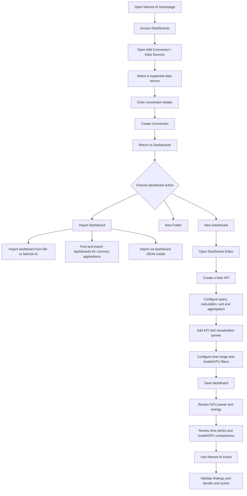

# **GPU & AI Model Power and Energy Analytics Dashboard**

Analyse GPU infrastructure and AI model energy usage—with an LLM-powered assistant that helps teams understand their KPIs, interpret patterns, and make better-informed decisions. 

The GPU & AI Model Power and Energy Analytics Dashboard, built with Netroot AI, helps organisations analyse power demand and energy consumption across both GPU infrastructure and AI models/workloads. It brings together GPU-level power measurements, model-associated energy analysis, utilisation and inference context, and interactive comparisons. This gives teams visibility into both the hardware consuming power and the AI workloads running on that hardware—helping them understand how infrastructure and model activity contribute to energy usage. 

A central part of the experience is Netroot AI Assist, powered by the Netroot AI LLM. It acts as an intelligent data-interpretation layer over the dashboard: helping technical and business users understand what KPIs mean, what the current values indicate, how GPUs and AI models compare, what has changed over time, and which questions or investigations should follow. Instead of requiring every stakeholder to interpret charts and metrics independently, users can explore the available dashboard context through natural-language questions and receive explanations grounded in the data made available to the assistant. 

 

## **1. Overview**

As organisations expand their use of AI models and GPU-powered workloads, energy visibility becomes important at two connected levels: the GPU infrastructure providing compute capacity and the models/workloads consuming that capacity. Understanding only device power or only model activity gives an incomplete picture. Analysing both can support operating-cost discussions, capacity planning, workload placement, and AI service efficiency. 

A single power reading provides only a snapshot. Teams also need to understand: 

How much power the selected GPU infrastructure is drawing. 

How energy consumption accumulates over a selected period. 

Which GPU types or devices account for a larger share of measured power or energy usage. 

How energy use is associated with supported AI models and workloads. 

Whether power demand changes alongside GPU utilisation or workload activity. 

How much energy is associated with a unit of inference output, when the required measurements are available. 

Which patterns deserve further investigation. 

The dashboard is designed to make these questions easier to explore from both infrastructure and workload perspectives. It combines GPU power and energy KPIs with model-associated analysis, workload context, and time-based comparisons. Netroot AI Assist adds an interpretation layer to help users understand the available evidence and consider what to investigate next. 

## **2. Capabilities**

The platform combines infrastructure telemetry, AI model analytics, interactive visualisation, configurable KPI analysis, and LLM-powered interpretation in one analytical workspace. 

Multi-Source Data Integration: Connect and unify telemetry from multiple Netroot AI Analytics-compatible data sources, including supported SQL databases and time-series data engines. 

Flexible Infrastructure and Workload Scope: Adapt the analytical workspace to supported compute environments, including CPU and GPU performance, memory utilisation, and cluster or network telemetry where relevant data sources and panels are configured. This solution focuses on GPU infrastructure and AI model/workload power and energy. 

Interactive Dashboarding: Explore telemetry through adjustable time ranges, configured refresh intervals, entity-based filters, and metric comparisons. 

Statistical KPI Engine: Support rolling statistical analysis, such as mean, median, and standard deviation, using configurable sample windows to reveal patterns and variations. 

Custom Query Builder: Allow authorised users to create domain-specific KPIs using supported native queries within Netroot AI Analytics, including custom calculations, filters, and aggregations. 

Query Optimisation: Support efficient retrieval through appropriate telemetry indexing, targeted time-range filters, explicit metric selection, and query practices suited to the connected data source. 

Netroot AI LLM Assistant: Provide an integrated LLM-powered assistant that helps users understand dashboard KPIs, charts, trends, and telemetry reports. It translates complex measurements and comparisons into contextual explanations for technical and business users. 

Intelligent Investigation and Recommendations: Analyse dashboard context made available to the assistant and suggest possible explanations for changes in power demand, energy consumption, utilisation, or model-associated metrics. It can recommend follow-up investigations, such as reviewing workload distribution, GPU utilisation, model-serving configuration, batch size, concurrency, and relevant KPIs. Suggestions support troubleshooting and decisions; they are not proof of root cause and must be validated against telemetry and infrastructure context. 

## **3. Opening the Dashboard**

Open the Netroot AI application URL supplied by your administrator or project team. The homepage is the entry point to the analytics environment.

*Netroot AI homepage*

If your deployment requires authentication, sign in using the credentials provided to you. From the homepage, open the **Dashboards** area to access existing dashboards or create a new one.

*Accessing the dashboard*

Open the relevant GPU and AI model power and energy analytics workspace. Select the required time range and use the configured refresh control or interval to update the displayed panels.

The dashboard URL, access method, available dashboards, and authentication requirements depend on the deployment environment.

## **4. Understanding the Dashboard**

The main analytical workspace presents telemetry through configured visualisation panels. Users can examine time-based power and energy patterns, compare GPU devices or types, review model-associated metrics where attribution is supported, and filter data to investigate particular infrastructure or workload configurations. 

## **4.1. Time-Series Visualisations**

Time-series panels display measurements against their recorded timestamps. They help users examine changes in GPU power, accumulated energy, utilisation, and available model/workload indicators over a selected period.

These views can help reveal sustained increases or decreases in GPU power demand, peaks and short-term fluctuations, changes in energy consumption, relationships between power demand and GPU utilisation, and changes in model-associated measurements alongside workload activity where available.

## **4.2. Multi-GPU and Model Comparisons**

*Model and GPU selection filters*

Use the model and GPU selectors to focus the dashboard on the models, GPU types, or devices you want to compare. Where the connected data contains suitable identifiers, users can compare measurements across GPU devices, GPU types, AI models, or workload configurations.

Comparisons should use consistent time ranges, measurement units, and attribution methods. A device-level GPU power reading must not be attributed in full to every model sharing that device.

## **5. Multiple Data-Source Integration**

Netroot AI Analytics can bring together data from multiple compatible backend sources within a unified analytical workspace. Depending on the deployed product configuration and supported connectors, these may include SQL databases and time-series data engines.

Users with the required permissions can configure connections through the platform's data-source settings. Available connection types, configuration fields, and access permissions depend on the deployment.

*Data-source selection and configuration*

Only list a specific database or time-series engine as supported in a client deployment after confirming that the required connector is available and configured.

## **6. Creating Custom KPIs in Netroot AI Analytics**

Organisations may have analytical requirements beyond the KPIs already included in a dashboard. Where the deployment provides an authorised query editor, users can define additional metrics using supported native queries against connected data sources.

*New dashboard editor*

Custom KPIs can calculate domain-specific measurements, apply filters, aggregate readings, or compare selected devices and workloads.

Examples of power- and model-oriented custom KPI areas include average and peak GPU power, energy consumption by GPU or GPU type, model-associated energy using a documented attribution method, energy per inference request where compatible measurements are available, inference output per unit of energy, and rolling power or energy statistics.

## **6.1. Custom KPI Design Considerations**

Define the operational or business question the KPI should answer. 

Confirm that the required source measurements are available. 

Select a consistent measurement scope and time interval. 

Use appropriate aggregation and filtering. 

Confirm the unit and calculation method. 

Validate the result against source measurements or an independent calculation before using it for operational or financial decisions. 

The exact query language and editor functionality depend on the connected data source and deployed Netroot AI Analytics configuration. Database-specific query examples should be added only after validation against the target environment. 

 

## **7. Statistical Performance and Energy Indicators**

Rolling statistical indicators can help smooth noisy telemetry and reveal changes in power demand, energy use, and workload behaviour. The sample window should be selected according to the sampling frequency and analytical question. 

Rolling Mean: Arithmetic average across the configured sample window; useful for identifying sustained power or utilisation trends. 

Rolling Median: Middle value across the configured sample window; useful for reducing the influence of short-lived spikes or outliers. 

Rolling Standard Deviation: Measures dispersion around the mean; useful for assessing variability and stability in power or utilisation readings. 

For example, a 15-reading window represents 15 samples, not necessarily 15 minutes. Its actual time span depends on the telemetry sampling interval. Interpret statistical results alongside raw measurements and the selected time range. 

 

## **8. Query and Data Retrieval Performance**

Efficient analytical queries help dashboards remain responsive, particularly with high-volume telemetry and longer time ranges. 

Time-Range Filtering: Restrict queries to the selected time interval wherever supported. 

Explicit Metric Selection: Retrieve only the measurements and identifiers required by a panel rather than every available field. 

Appropriate Indexing: Where supported, use indexes aligned with common filters and time-range access patterns, such as device or entity identifiers combined with timestamps. 

Consistent Aggregation: Aggregate at the correct level and avoid duplicating device-level readings through joins to model or workload records. 

Bounded Analysis: Use suitable sample windows and aggregation intervals for the selected time range. 

The best optimisation approach depends on the source database, telemetry volume, schema, and query engine. Index definitions and query plans should be validated in the target deployment. 

 

## **9. What You Can Monitor**

*Power consumption overview*

*GPU power consumption*

*Peak power consumption*

The dashboard can present the following categories, subject to the panels enabled and measurements available in a deployment. 

GPU Infrastructure 

Total GPU Power (W): Combined power demand across the selected GPU scope. 

Average GPU Power (W): Average power draw over the selected period. 

Peak GPU Power (W): Highest observed GPU power reading within the selected scope and period. 

Power-Limit Utilisation (%): Measured GPU power relative to its configured power limit. 

GPU Utilisation (%): GPU processing utilisation. 

GPU Memory Utilisation (%): GPU memory usage relative to available capacity. 

Energy Consumption by GPU (kWh or J): Accumulated energy associated with individual GPUs or GPU groups, where available. 

Power Consumption Over Time: Time-series view of GPU power demand. 

AI Models and Workloads 

Model-Associated Energy: Energy attributed to supported models using request-level measurements or a documented allocation method. 

Energy per Inference Request: Energy associated with an inference request, where compatible energy and request measurements are available. 

Inference Throughput: Requests or generated tokens processed over a defined interval, where recorded. 

Tokens per kWh or Tokens per J: Energy-efficiency indicators for token-generating workloads, where token output and energy measurements are available. 

Model-Level Comparison: Comparison of model-associated energy and workload indicators using consistent measurement periods and attribution rules. 

Model and GPU Comparison: Comparison of selected model/GPU combinations where the underlying records support that relationship. 

Cross-Metric and Time-Based Analysis 

Power and Utilisation Relationship: Explore how GPU power readings change alongside utilisation. 

Energy Consumption Over Time: Review accumulated energy across a selected period. 

Rolling Mean, Median, and Standard Deviation: Understand typical values and variability across a configured sample window. 

GPU or Model Comparison Views: Compare selected entities using available and correctly attributed measurements. 

Custom KPI Flexibility: Where the deployment provides an authorised query editor and the required source data, users can define additional KPIs for specific business requirements, operational objectives, and analytical questions. A custom KPI should have a documented definition, unit, calculation method, and measurement scope. 

 

## **10. Using the Model and GPU Filters**

Where enabled in the deployed dashboard, model and GPU selectors allow users to focus analysis on particular AI models, GPU types, or devices. 

## **10.1. Select an AI Model**

Open the model selector. 

Choose one or more available model names. 

Apply the selection if the interface requires confirmation. 

Review the KPI cards, charts, and comparison panels for the selected models. 

## **10.2. Select a GPU**

Open the GPU selector. 

Choose one or more available GPU types or devices. 

Apply the selection if required. 

Review the updated power, energy, and utilisation panels. 

## **10.3. Compare Model and GPU Configurations**

Select the models you want to inspect. 

Select the GPU types or devices you want to compare. 

Review the KPI cards for a summary of the selected scope. 

Use model-level charts and comparison panels to inspect the available breakdown. 

Change one filter at a time when investigating differences between configurations. 

The available combinations depend on the records, filters, and relationships exposed by the connected telemetry data source. Model-level energy comparisons require a valid attribution method. 

 

## **11. Business Challenges and How the Dashboard Helps**

GPU-intensive environments can be difficult to assess using isolated device readings or disconnected operational reports. The dashboard brings relevant measurements into a common analytical view. 

Business challenge 

How the dashboard can help 

Limited visibility into GPU power demand 

Present power measurements across the selected GPU scope and time period. 

Difficulty identifying high-consumption devices 

Compare power and accumulated energy across GPU types or individual devices where identifiers are available. 

Unclear energy trends 

Review time-based power and energy patterns, including peaks and sustained changes. 

Limited understanding of workload energy usage 

Relate GPU measurements to model and inference context where the underlying data supports that relationship. 

Difficulty assessing operational efficiency 

Compare energy consumption with inference output or workload activity when the required measurements are available. 

Hard-to-interpret dashboards 

Use Netroot AI Assist to explain metrics, compare observations, and suggest areas for investigation. 

Energy information is difficult to use in cost discussions 

Use measured energy and an applicable electricity tariff to estimate electricity expenditure for a clearly defined scope. 

The dashboard provides analytical visibility across both GPU infrastructure and AI model workloads. It does not, by itself, guarantee lower electricity costs or automatically optimise infrastructure or model execution. 

## **12. What the Dashboard Helps Organisations Understand Across GPUs and Models**

*Energy consumption across models*

*GPU-by-model power consumption*

*Model and GPU comparison table*

*GPU power consumption trend*

*Model power consumption trend*

## **12.1. Energy Consumption Across GPUs**

Organisations can compare power draw and accumulated energy consumption across the selected GPU population. Where device-level information is available, they can also examine individual devices. 

This helps teams understand: 

Which GPU types or devices draw the most power. 

How much each GPU contributes to the selected infrastructure's overall power demand. 

Whether power consumption is stable, increasing, or fluctuating. 

Which devices repeatedly approach their configured power limits. 

Whether high power draw coincides with high GPU utilisation. 

How energy consumption accumulates over a selected period. 

These insights can support infrastructure reviews, workload placement discussions, capacity planning, and decisions about GPU resource allocation. 

## **12.2. Energy Consumption Across AI Models and Workloads**

GPU-level power monitoring is useful, but organisations may also need to understand how energy usage relates to the AI workloads running on that infrastructure. 

By relating power telemetry to model and inference information, the dashboard can help compare model-associated power and energy usage where the underlying measurements support that relationship. 

Teams can investigate: 

Which models are associated with higher energy usage. 

How energy consumption changes as request volume or workload activity changes. 

Whether particular models or workloads are associated with higher power demand. 

How models compare over consistent measurement periods. 

How much energy is associated with processing inference requests. 

Whether changes in model configuration, request volume, concurrency, or generated output coincide with changes in energy use. 

Attribution matters: A physical GPU may run multiple models or workloads. A device-level power reading must not be counted in full against every model using that GPU. Model-level energy attribution should use request-level measurements or a documented allocation method. Comparisons should use consistent measurement periods and clearly defined attribution rules. 

## **12.3. Power Trends and Peak Consumption**

Time-series analysis helps teams move beyond isolated readings and understand how power draw changes over time. 

Users can investigate: 

Sustained increases or decreases in power demand. 

Short-lived peaks and unusual fluctuations. 

Differences in power patterns across GPU types or devices. 

Changes that occur alongside workload or utilisation changes. 

Repeated operation near configured power limits. 

This can help distinguish a temporary spike from a sustained increase that may require operational attention. 

## **12.4. Energy Consumption Over Time**

Power and energy describe different things: 

Power (W) is the rate at which electrical energy is being used at a particular moment or over a measurement interval. 

Energy (J or kWh) is the accumulated amount of energy consumed over time. 

The dashboard supports analysis of both power demand and accumulated energy. This distinction is important for understanding not only how much power GPUs draw at a given time, but also how much energy their operation consumes over a selected period. 

## **13. Key Dashboard Capabilities Across Infrastructure and AI Workloads**

The dashboard treats GPU infrastructure and AI models as complementary dimensions of energy analysis: GPU views help explain hardware power demand, while model/workload views help explain how energy use relates to the AI activity running on that infrastructure. The available views depend on connected telemetry, workload data, attribution methods, and configured KPIs. 

GPU power overview — review power demand across the selected GPU scope and understand the hardware-side energy profile. 

AI model energy overview — examine model-associated energy usage and compare the energy profiles of supported models and workloads. 

Power comparison by GPU — compare power draw across GPU types or individual devices where identifiers are available. 

Model comparison — compare model-associated energy, inference activity, and efficiency indicators where the required measurements are available. 

Model-associated power and energy analysis — explore how GPU power and energy measurements relate to different models and workloads using a defined, documented attribution method. 

Energy consumption analysis — examine accumulated energy over a selected period. 

Power trends over time — inspect changing power demand, peaks, and sustained patterns. 

Peak power monitoring — identify the highest observed GPU power reading within the selected scope and period. 

Power-limit utilisation — understand how close measured power is to a configured GPU power limit. 

GPU utilisation context — compare power demand with GPU processing utilisation. 

Memory utilisation context — review power patterns alongside GPU memory usage. 

Inference and workload context — relate energy measurements to available model and inference activity. 

Energy efficiency analysis — evaluate inference output relative to energy consumed when the required measurements are available. 

Interactive filtering — focus analysis on selected models, GPU types, and time ranges. 

Refresh-based monitoring — review changing measurements through the dashboard's configured refresh and time-range controls, where the connected data source provides updates. 

## **14. GPU and Model KPI and Measurement Overview**

The dashboard can bring together power, energy, utilisation, and workload measurements. The exact KPIs available depend on the connected telemetry and the metrics configured for the dashboard. 

KPI / Measurement 

What it helps answer 

Typical unit 

Total GPU Power Consumption 

What is the combined power draw across the selected GPUs? 

W 

Average GPU Power 

What is the average power draw for a GPU or selected GPU group? 

W 

Peak GPU Power 

What is the highest individual GPU power reading in the selected scope and period? 

W 

Power-Limit Utilisation 

How much of the configured GPU power limit is being used? 

% 

Total Energy Consumption 

How much energy was consumed during the selected interval? 

kWh or J 

Energy Consumption by GPU 

How much energy is associated with each GPU or GPU type? 

kWh or J 

Model-Associated Energy 

How much energy is attributed to each model using the defined method? 

kWh or J 

Energy per Inference Request 

How much energy is associated with an inference request? 

J/request 

GPU Utilisation 

How much GPU processing capacity is in use? 

% 

GPU Memory Utilisation 

How much GPU memory is in use? 

% 

Power Consumption Over Time 

How does GPU power draw change over the selected period? 

W 

Energy Consumption Over Time 

How does accumulated energy change over the selected period? 

kWh or J 

Energy Efficiency 

How much inference output is produced relative to energy consumed? 

tokens/kWh or tokens/J 

Measurement conventions 

Convert joules to kilowatt-hours using: kWh = J / 3,600,000. 

When energy is estimated from average power, use: Energy (J) = Average Power (W) × Elapsed Time (seconds). 

Power-limit utilisation can be calculated as: (GPU Power / Configured Power Limit) × 100. 

Energy per request requires energy and request counts from matching populations and measurement intervals. 

Efficiency metrics must state their formula and unit. For example, tokens/kWh and tokens/W are not interchangeable. 

Total infrastructure power should sum distinct physical GPU readings for a consistent measurement scope. Avoid counting the same device-level reading multiple times through model relationships. 

## **15. Netroot AI Assist — Turning Dashboard Data into Understanding**

*Netroot AI Assist overview*

*Netroot AI Assist response*

A dashboard makes measurements visible, but visibility alone does not guarantee understanding. Different stakeholders may look at the same KPI and ask different questions: an infrastructure engineer may want to understand a power spike, an AI/ML team may want to compare model energy profiles, and a business manager may want to understand what the numbers mean for operating costs and capacity planning. 

Netroot AI Assist, powered by the Netroot AI LLM, is a core interpretation layer of the platform—not simply a place to ask generic questions. It helps bridge the gap between raw measurements, dashboard KPIs, and the decisions people need to make. Using the dashboard context made available to it—such as KPI values, charts, trends, selected models, GPU comparisons, filters, units, and time ranges—it can explain the information in natural language and guide users through follow-up analysis. 

This is particularly valuable for organisations where not every stakeholder is a data analyst or GPU specialist. Users can ask questions in everyday language, understand technical metrics without having to decode every chart themselves, and use the assistant to explore the evidence behind an observation. 

The assistant's responses should be grounded in the available dashboard context. If a KPI, measurement, or comparison is not present in the supplied data, it should not be presented as a verified finding. 

## **15.1. Help Every Stakeholder Understand the KPIs**

Netroot AI Assist can explain dashboard metrics in business-friendly language, including what a KPI measures, why it matters, how to interpret its unit, and what questions it can help answer. 

For example, users can ask: 

Total GPU Power (W): “What does total GPU power tell us about our current infrastructure demand?” 

Average and Peak Power (W): “What is the difference between average power and peak power, and why should we monitor both?” 

Energy Consumption (kWh): “How much energy was consumed during this time range, and how is that different from power?” 

Power-Limit Utilisation (%): “What does it mean when a GPU is operating close to its configured power limit?” 

Energy per Inference: “How should we interpret energy per request, and what measurements are needed to calculate it reliably?” 

Tokens per kWh: “What does this efficiency metric tell us when comparing model-serving workloads?” 

This KPI explanation capability can help onboard new users, reduce confusion around units and definitions, and make dashboard reviews more productive. The accuracy of each explanation depends on the KPI definition and measurement context configured for the deployment. 

## **15.2. Translate Data into Business-Relevant Understanding**

The same data can have different implications for different teams. Netroot AI Assist can help users explore those implications in language suited to the question being asked. 

Stakeholder 

Questions the assistant can help explore 

Potential business value 

Infrastructure leadership 

Which GPUs show higher power demand? Are there sustained increases or repeated peaks? 

Better visibility into infrastructure demand and areas for operational review. 

GPU / platform engineers 

What changed around a power spike? Does utilisation move with power? 

Faster investigation of telemetry patterns and more focused troubleshooting. 

AI/ML engineering 

How do supported models compare in energy use? What workload factors should we examine? 

Better-informed model-serving and workload-efficiency evaluations. 

FinOps / cost teams 

What does measured energy imply for estimated electricity expenditure at our tariff? 

A clearer basis for energy-related cost discussions, subject to measurement scope and tariff assumptions. 

Management 

What are the main trends and which areas warrant attention? 

More accessible summaries for reviews, planning, and stakeholder communication. 

The assistant can help explain and organise evidence; it does not independently certify financial savings, operational root causes, or business outcomes. 

## **15.3. Ask Follow-Up Questions and Explore the Data Conversationally**

Users do not have to stop after receiving a single answer. They can ask follow-up questions to clarify a KPI, compare two GPUs or models, narrow the time period, or ask why a particular pattern matters. 

A typical exploration might look like this: 

Ask which GPU group has the highest measured energy consumption. 

Ask how that group's power trend changed during the selected period. 

Ask whether GPU utilisation changed at the same time. 

Ask what workload or telemetry details could help explain the pattern. 

Ask for practical checks the engineering team could perform next. 

This conversational approach helps users move from a broad observation to a more focused investigation without needing to know every technical query or chart interaction in advance. The assistant can only answer comparisons and follow-ups supported by the context and data it receives. 

## **15.4. Support Different Levels of Technical Knowledge**

Netroot AI Assist can make the same dashboard more approachable to different audiences: 

Non-technical stakeholders can ask for plain-language summaries of key KPIs and trends. 

Business analysts can ask for comparisons, explanations, and concise summaries for operational reviews. 

Engineers and data teams can explore metric relationships, unusual patterns, and additional telemetry needed to validate a hypothesis. 

Decision-makers can ask what the observed measurements may mean for energy visibility, workload planning, and infrastructure discussions. 

This makes the dashboard easier to discuss across teams while keeping the underlying measurements and caveats visible. 

## **15.5. Identify Patterns and Potential Explanations**

Users can ask Netroot AI Assist to explain the dashboard in plain language. Depending on the data available, it can help describe: 

Which selected GPU type or device has the highest observed power draw. 

Which GPU group accounts for the largest share of energy consumption. 

Whether power consumption has increased or decreased over the selected period. 

Which models are associated with higher energy usage under the available attribution method. 

Whether high power readings occur alongside high GPU utilisation. 

Whether energy consumption is increasing because of higher power demand, longer operating time, or both, where the available measurements allow that distinction. 

## **15.6. Explore GPU-Level and Model-Level Energy Usage**

Netroot AI Assist can help users compare energy-related KPIs across GPUs and models, subject to the quality and attribution of the underlying data. 

Example questions include: 

Which GPU type consumed the most energy during this period? 

Which model is associated with the highest energy usage? 

How does the energy profile of one model compare with another? 

Did energy consumption increase when inference activity increased? 

Which GPU or workload should we investigate first? 

## **15.7. Identify Patterns and Potential Explanations**

The LLM can help interpret patterns visible in the dashboard and suggest possible factors to investigate. 

Dashboard observation 

Possible factors to investigate 

Power rises while GPU utilisation also rises. 

Increased workload demand, higher concurrency, larger batches, or more computationally intensive activity. 

Power remains high while GPU utilisation is relatively low. 

Idle-but-powered devices, workload scheduling, background processes, or measurement alignment. 

One GPU type consistently draws more power. 

Hardware differences, configured power limits, device configuration, or differences in workload intensity. 

Energy consumption rises over a longer period while power remains relatively stable. 

Longer operating duration or more accumulated runtime. 

A model-associated energy metric increases. 

Changes in request volume, input/output sizes, concurrency, model configuration, or the attribution method. 

Power readings repeatedly approach configured limits. 

Sustained demand, workload concentration, or power-limit configuration. 

These explanations are investigative possibilities, not automatic proof of root cause. Netroot AI Assist should distinguish measured observations from hypotheses and make clear when additional telemetry is needed. 

## **15.8. Provide Suggestions That Support Better Decisions**

Based on the available evidence, Netroot AI Assist can suggest practical areas for review, such as: 

Workload distribution: Review whether energy demand is concentrated on a small number of GPUs and whether workloads could be distributed more appropriately. 

GPU utilisation: Investigate periods where power draw is comparatively high despite low utilisation. 

Model and workload comparison: Compare model-associated energy usage using consistent measurement periods and defensible attribution. 

Power-limit review: Examine devices that repeatedly operate close to their configured power limits. 

Inference configuration: Investigate request volume, batch size, concurrency, and generated output when these coincide with increased energy consumption. 

Infrastructure planning: Use historical power and energy patterns to inform capacity planning and GPU resource allocation. 

Efficiency monitoring: Track energy relative to inference output to evaluate whether changes improve efficiency without compromising workload requirements. 

These suggestions help teams move from identifying a metric to considering a practical next step. Operational changes should still be validated against workload requirements, service quality, and subsequent telemetry. 

## **15.9. Example Questions**

“Explain the energy consumption trend over the selected period.” 

“Which GPU group is consuming the most energy?” 

“Which model is associated with the highest energy usage?” 

“What changed when power consumption increased?” 

“Does GPU utilisation appear to correlate with power draw?” 

“What should we investigate to improve energy efficiency?” 

“What does the current power and energy profile suggest about infrastructure usage?” 

## **15.10. A Useful Structure for AI-Generated Insights**

For useful and accountable decision support, an insight should ideally contain: 

Observation — what the dashboard data shows. 

Evidence — the KPI values, time range, or comparison supporting the observation. 

Possible explanation — contributing factors that may explain the pattern, clearly labelled as hypotheses. 

Suggestion — a practical next step tied to the evidence. 

Validation — additional measurements or checks needed to confirm the explanation. 

The LLM supports human decision-making; it does not replace engineering judgement, operational validation, or financial review. 

## **16. Enterprise Use Cases Across Infrastructure and AI Models**

Infrastructure and Engineering Teams 

Identify GPUs with consistently high power demand. 

Compare energy usage across GPU types and devices. 

Review power trends alongside utilisation and workload activity. 

Investigate underutilised resources that continue to consume significant power. 

Use observed patterns to inform workload placement and resource allocation. 

AI and Model Operations Teams 

Compare energy associated with different models and inference workloads. 

Examine how request volume, concurrency, and output activity relate to energy consumption. 

Evaluate energy per inference request where measurements are available. 

Monitor energy efficiency when changing model-serving configurations. 

Use consistent measurements to investigate which workloads may benefit from optimisation. 

FinOps and Cost Management Teams 

Energy measurements can help organisations estimate electricity expenditure when an applicable electricity tariff is available. 

Estimated Electricity Cost = Energy Consumed (kWh) × Electricity Tariff (cost per kWh) 

This can help teams: 

Estimate electricity expenditure for a selected GPU group or measurement period. 

Compare energy-related operating costs across infrastructure configurations. 

Understand how longer operating periods and higher energy consumption affect expenditure. 

Bring energy usage into infrastructure budgeting and capacity-planning discussions. 

Identify areas where efficiency improvements may reduce electricity costs. 

Actual cost estimates depend on the applicable tariff, billing structure, measurement scope, and any relevant additional charges. GPU energy measurements should not be presented as a complete facility electricity bill unless the measurement scope includes the relevant facility loads. 

Management and Strategic Decision-Making 

Consolidated power and energy information can support: 

Better-informed GPU procurement and capacity-expansion discussions. 

Comparisons of infrastructure utilisation and energy demand. 

Planning for the operating costs of AI workloads. 

Evaluation of energy-efficiency initiatives. 

More transparent reporting on infrastructure energy consumption. 

The dashboard provides measurable evidence for these discussions, while Netroot AI Assist helps make the evidence easier to interpret. 

## **17. Example Operational Scenario**

Scenario: An organisation operates multiple GPUs to serve AI inference workloads. 

Monitor: The infrastructure team reviews GPU power and energy measurements over a selected period. 

Compare: The team identifies devices or GPU groups with higher-than-expected consumption. 

Investigate: Engineers compare power trends with GPU utilisation and available workload activity. 

Assess workloads: The AI/ML team reviews model-associated energy metrics where the data supports reliable attribution. 

Interpret: Netroot AI Assist explains the observed patterns and suggests relevant checks. 

Validate: The team checks additional telemetry and confirms whether the suspected contributing factors are present. 

Improve and review: If an operational change is justified, the team applies it through its normal processes and compares subsequent measurements. 

This example illustrates a possible way to use the analytics. It is not a claim that the platform automatically performs workload scheduling, optimisation, or corrective actions. 

## **18. Analytical Approach**

The dashboard brings together several complementary forms of analysis: 

Time-series analysis: Understand how power and energy measurements change over time. 

Comparative analysis: Compare consumption across GPU types, devices, and models. 

Relationship analysis: Examine how power draw relates to GPU utilisation, memory utilisation, and available workload measurements. 

Energy analysis: Evaluate accumulated energy over a selected period. 

Efficiency analysis: Relate inference output to energy consumption when the required measurements are available. 

Custom KPI analysis: Extend the dashboard with metrics aligned to operational and organisational requirements. 

## **19. High-Level Workflow**

The solution follows an end-to-end analytics workflow: 

Telemetry collection — collect GPU power, energy, utilisation, memory, and relevant workload measurements. 

Data preparation — validate and prepare the measurements for analysis. 

Centralised data access — make the prepared information available through a supported data source. 

Platform connection — connect the data source to Netroot AI. 

KPI development — define power, energy, comparison, and efficiency measurements. 

Dashboard creation — organise the metrics into interactive visualisations and analytical views. 

AI-assisted interpretation — provide relevant dashboard context to Netroot AI Assist. 

Investigation and action — review the findings, validate possible explanations, and decide on appropriate operational improvements. 

## **20. Measurement Scope and Data Considerations**

Reliable analysis depends on the quality, coverage, and consistency of the underlying measurements. Before using dashboard results for operational or financial decisions, organisations should consider the following: 

Power versus energy: Power is measured in watts (W); energy is measured in joules (J) or kilowatt-hours (kWh). 

Measurement boundary: Confirm whether measurements cover individual GPUs, a server, a cluster, or a wider facility. GPU telemetry alone does not represent total data-centre electricity consumption. 

GPU population: Aggregate power only across distinct physical GPU readings within a consistent measurement scope. 

Model attribution: Device-level power readings cannot be assigned in full to every model sharing a GPU. Model-level energy analysis requires request-level measurements or a documented allocation method. 

Time alignment: Energy, request counts, utilisation, and workload measurements should refer to compatible time intervals and populations. 

Efficiency definitions: State the numerator, denominator, and unit. For example, tokens/kWh and tokens/W represent different measures. 

Cost estimates: Use the applicable electricity tariff and clearly define which loads are included. Additional facility, cooling, distribution, and billing charges may not be represented by GPU-only measurements. 

AI-generated interpretation: Treat explanations of possible causes as hypotheses until validated with relevant telemetry and operational checks. 

Comparability: Compare GPUs or models using consistent time ranges, aggregation methods, and attribution rules. 

Clear measurement boundaries make the dashboard's findings more useful and reduce the risk of misleading comparisons. 

## **21. Capability Scope**

The dashboard's capabilities depend on the actual implementation and the data connected to it. The following distinctions help set clear expectations for evaluation and deployment. 

Capability category 

Meaning 

Dashboard functionality 

Views and KPIs that are implemented and available in the deployed application. 

Data-dependent analysis 

Insights that can be produced when the required telemetry, workload context, and measurement coverage are available. 

Potential extensions 

Additional capabilities that may be developed to meet future organisational requirements. 

Examples such as model-level energy attribution, energy per inference, tokens per kWh, cost estimation, and multi-node analysis require suitable source measurements and validated calculation methods. They should only be treated as available product capabilities when they have been implemented and verified in the target deployment. 

## **22. Step-by-Step Workflow: Using Netroot AI for Power and Energy Analysis**

Follow this workflow to open Netroot AI, connect a telemetry source, create or import a dashboard, build KPIs, analyse GPU and model power/energy measurements, and use Netroot AI Assist to interpret the results.

### **22.1. End-to-End Workflow Flowchart**

### **22.2. Open the Netroot AI Homepage**

Open the Netroot AI application URL supplied by your administrator or project team.

*Netroot AI homepage*

### **22.3. Access the Dashboard**

From the homepage, open the **Dashboards** area.

*Accessing the dashboard*

### **22.4. Add a Data Source**

Open **Add new connection** or the relevant data-source settings, then choose a supported data-source type.

*Data-source selection and configuration*

### **22.5. Create the Connection**

Enter the required connection details, such as host/server, port, database, authentication information, and connector-specific settings. Validate the details if a test option is available, then create or save the connection. The exact fields depend on the selected connector and deployment permissions.

*Adding a new connection*

### **22.6. Return to Dashboards and Choose an Action**

After creating the connection, return to **Dashboards**. The dashboard page provides three starting options:

- **New Dashboard** — create a dashboard for GPU power, energy, model, and inference analysis.
- **New Folder** — create a folder to organise dashboards.
- **Import Dashboard** — bring an existing dashboard into the workspace.

*Dashboard creation options*

#### **22.6.1. New Dashboard**

Choose **New Dashboard** to create a dashboard from scratch. Continue to the dashboard editor and build the required panels and KPIs.

#### **22.6.2. New Folder**

Choose **New Folder** to group dashboards by project, environment, team, or analytical purpose.

#### **22.6.3. Import Dashboard**

The Import Dashboard option presents three import routes:

1. **Import dashboard from file or Netroot AI** — import a dashboard file or select an available dashboard from Netroot AI.
2. **Find and import dashboards for common applications** — browse and import dashboards designed for commonly used applications.
3. **Import via dashboard JSON model** — import a dashboard using its JSON model definition.

After importing, review the dashboard's data-source references, queries, and variables. Map them to connections available in your environment where required.

### **22.7. Open the Dashboard Editor**

After selecting **New Dashboard**, open the dashboard editor to add and arrange analytical panels.

*New dashboard editor*

### **22.8. Create a New KPI**

Add a new KPI or panel and select the connected data source. Define the required metric using the query or calculation features available in your deployment.

*Creating a new KPI*

### **22.9. Configure and Save the KPI**

For each KPI:

1. Give it a clear, descriptive name.
2. Select the required source measurements and filters.
3. Define the calculation and aggregation.
4. Set the correct unit, such as W, J, kWh, %, or tokens/kWh.
5. Validate the result against the underlying measurements.
6. Save the KPI and add it to the dashboard.

### **22.10. Build the Analytical Dashboard**

Add and arrange KPI cards, time-series charts, comparison tables, and other supported visualisations. Typical analysis areas include GPU power consumption, peak power, energy over time, GPU-level comparisons, model-associated energy where attribution is supported, and inference output per unit of energy where the required measurements are available.

### **22.11. Apply Model/GPU Filters and Review Trends**

Use the available time-range, model, and GPU filters to focus the analysis. Compare consistent time periods and measurement scopes. Review time-series readings, GPU power trends, model-associated energy, and GPU/model comparison views.

### **22.12. Use Netroot AI Assist**

Use Netroot AI Assist to ask natural-language questions about the dashboard context made available to the assistant. Ask it to explain KPI values, summarise trends, compare GPUs or models, and suggest what to investigate next. Treat causal explanations as hypotheses and validate them against telemetry and operational evidence.

### **22.13. Validate Findings and Make Informed Decisions**

Check the assistant's interpretation against KPI values, time ranges, units, and source measurements. Confirm suspected causes with appropriate engineering or operational checks before changing workload placement, GPU configuration, or model-serving settings.

## **23. Extensibility**

As telemetry coverage and organisational requirements evolve, potential areas for further development may include: 

Additional GPU vendors, accelerator types, and devices. 

Multi-node infrastructure energy analysis. 

More detailed model- and workload-level energy attribution. 

Additional inference efficiency measurements. 

Historical energy reporting and comparisons. 

Threshold-based monitoring and alerts. 

Additional AI-assisted investigation and recommendation workflows. 

These are potential extension areas, not a representation that every item is currently available. 

## **24. Conclusion: Connecting GPU Infrastructure with AI Workload Energy**

The GPU & AI Model Power and Energy Analytics Dashboard helps organisations understand two connected questions: how much power and energy their GPU infrastructure consumes, and how that energy usage relates to the AI models and workloads running on it where the underlying data supports the analysis. 

By connecting GPU-level monitoring with model- and workload-oriented energy analysis, time-based comparisons, utilisation context, and energy-related KPIs, the dashboard can support infrastructure reviews and AI model evaluation together. Organisations can examine hardware power demand alongside the energy profile of the workloads they operate, supporting energy visibility, cost discussions, efficiency reviews, and capacity planning. 

Netroot AI Assist, powered by the Netroot AI LLM, is a key part of the platform's value. It helps clients and business stakeholders understand what their KPIs mean, interpret GPU- and model-level data, ask follow-up questions in natural language, compare observed patterns, and identify practical areas for investigation. This reduces the gap between having telemetry and being able to use it in conversations about engineering operations, AI workload efficiency, energy expenditure, and infrastructure planning. Together, the analytics dashboard and its LLM-powered assistant help organisations move from viewing data to understanding it—and from understanding it to making better-informed decisions.
